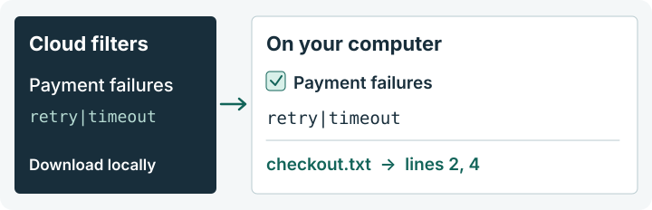

# Cloud connection and filter sync

[简体中文](../zh-CN/Cloud-Filters.md) · [Guide home](Home.md)

## What you can sync

A team can share named queries on one filter server. Each filter includes its name, match value, regex setting and note. For example, one person can publish **Payment failures** so others can download it and search their own logs for `retry|timeout`. Log files and search results stay on each computer. You choose when to download, update or publish a filter. Downloaded filters also work offline.

<a id="connect"></a>

## Download the server and connect

If your team already runs a compatible service, ask its operator for the base URL and go straight to step 4. To try the server on your own computer, start at step 1.

1. **Download and extract the server.** Open a release with server packages on [VCLogg2 Releases](https://github.com/zhaiyanqi/vclogg2/releases) and expand **Assets**. Choose `vclogg-server-<version>-windows-amd64.zip` for Windows x64 or `vclogg-server-<version>-linux-amd64.tar.gz` for Linux x64. Extract it and open a terminal in the directory containing `config.example.yaml`.
2. **Prepare the configuration.** On first use, run `Copy-Item config.example.yaml config.yaml` in Windows PowerShell or `cp config.example.yaml config.yaml` on Linux. The current desktop client sends an unsigned registration request. The server requires a signature by default. For an isolated local trial only, keep `listen: 127.0.0.1:8787` and set `enabled` to `false` in the `client_auth` section of `config.yaml`. For team use, obtain an HTTPS endpoint that supports the desktop client’s registration method.
3. **Start the service.** To use the admin console for the first time, run the `admin create` command below and enter an administrator password when prompted. For subsequent starts, run just the `serve` command. Leave the terminal running. You can open the [admin console](http://127.0.0.1:8787/admin/) on the server computer.

   **Windows PowerShell**

   ```powershell
   .\vclogg-server.exe admin create -config ./config.yaml -username admin
   .\vclogg-server.exe serve -config ./config.yaml
   ```

   **Linux**

   ```sh
   chmod +x ./vclogg-server
   ./vclogg-server admin create -config ./config.yaml -username admin
   ./vclogg-server serve -config ./config.yaml
   ```

4. **Connect the desktop client.** Open **Tools → Settings → Cloud connection**. Enter the base URL under **Server address**. Use `http://127.0.0.1:8787` for a server on the same computer, or your team’s URL from another computer. Enter an employee ID or nickname under **User name** and choose **Test connection**. A success message confirming a cookie was obtained means you can start syncing.

<a id="use-filters"></a>

## Use cloud filters

### Download a teammate’s rule

1. From the search bar, open **Filters → Edit predefined filters…** and choose **Cloud filters**. You can also reach the editor from **Tools → Predefined filters…**.
2. Search by name, keyword, note or sharer. Open an entry to see its match value and revision.
3. Choose **Download locally**, or select several entries and choose **Download/update selected**. In **Local filters**, check that the rule is available. Return to the log and check the rule in **Filters** to use it.



### Try a filter on your own

1. Open **Tools → Predefined filters… → Local filters**. Select **+**, name the filter **Payment failures**, enter `retry|timeout` as the match value and leave regex off. Choose **Done** in the detail view, then **OK** in the local list.
2. Open the [walkthrough log](Getting-Started.md). Start with an empty query in **Current** scope. Open **Filters** on the search bar and check **Payment failures**. The query field now contains the two keywords.
3. Click the search button. In **Matches only**, lines 2 and 4 appear. You can use the same filter in a global or directory search.

### Share a new rule or update one

Select a saved local filter, choose **Share** and confirm the selected entry. For an already shared filter, save your edits locally, inspect its details and choose **Submit local changes** to publish a revision.

| When you update a filter | What to do |
| --- | --- |
| Only the server has changes | Choose **Update local** to bring them in. |
| Both copies changed | Open the cloud entry and choose **Merge update** or **Resolve conflict**. The example below shows what each person keeps. |
| You want a variation for a different project | Choose **Save as new filter**. It gets its own UUID even if its name and match value are the same. |
| You need an older revision | Choose **Restore locally** in the history. Review it before submitting another revision. |

A concurrent edit may require another review before submission. Removing a remote share leaves your local rule available. The local list also supports import/export. JSON export uses v5 and import accepts earlier v1–v4 files, arrays and legacy Qt CONF/INI files. Existing local rules absent from an import are kept.

### Two people edited Payment failures. Which values survive?

Suppose you and a teammate downloaded the same rule. Its note originally said “Check payments”. You changed the name and note locally. Your teammate changed the note on the server. Open the cloud entry and choose **Resolve conflict**.

| Field | Your saved copy | New cloud revision | Your copy after the merge |
| --- | --- | --- | --- |
| Name | Payment timeouts and retries | Payment failures (original name) | Payment timeouts and retries |
| Note | Ask the payments team | Notify the on-call engineer | “Notify the on-call engineer” if you choose **Use remote** |

Only the note needs a decision. To keep “Ask the payments team”, choose **Keep local** beside the note. Choose **Complete merge** and check both fields in your local copy. If you want to ask your teammate first, choose **Resolve later** to keep the original common revision for comparison. When you have editing permission and local changes to share, choose **Submit local changes** to publish the merged version.

### If the connection or sharing fails

- **Connection fails.** Verify the service URL and authentication with its operator. The desktop client registers unsigned. The bundled Go server defaults to signed registration (`client_auth.enabled: true`) and may reject this client. Production deployments need compatible registration. Disabling that protection is limited to isolated development.
- **Sharing is disabled.** Check whether the server advertises `filter-uuid-branches-v1`. Older servers can still support browsing and downloads.
- **Working offline.** You can browse previously cached public pages and bring in safely newer cached revisions. Publishing, liking, remote deletion and retrieving revision history need a connection.

Requests use the service’s `/api/v1` endpoints on demand. Public connection settings are stored in SQLite. Session files under `cloud/sessions/` contain cookies and CSRF data without additional encryption. Keep them out of shared diagnostic attachments. [Local data and privacy](Data-and-Privacy.md) · [Filter revision reference](Filter-Branch-Acceptance.md)
