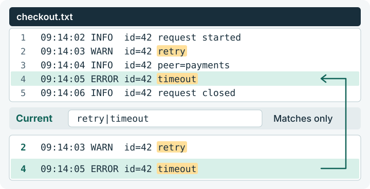

# Trace your first timeout

[简体中文](../zh-CN/Getting-Started.md) · [Guide home](Home.md)

A checkout request retried and then timed out. Which service was the request waiting for? You can answer that with a search and a single mark.

## Open the example

Save the [sample log](examples/checkout.txt) to your computer, or copy the five lines below into a plain text file named `checkout.txt`. Choose **File → Open…** and select it. The file opens in its own tab with the original lines in order.

```text
09:14:02 INFO  id=42 request started
09:14:03 WARN  id=42 retry
09:14:04 INFO  id=42 peer=payments
09:14:05 ERROR id=42 timeout
09:14:06 INFO  id=42 request closed
```

## Find the failure

1. Press **Ctrl+F** (macOS **⌘F**) to focus the main search field. Choose **Current** and turn regex off.
2. Enter `retry|timeout` and press **Enter**. The vertical bar means “either word” in this search. Choose **Matches only** in the results.
3. Select the result numbered **4**. The log above reveals the timeout. On line **3**, `peer=payments` identifies the service.



If you see fewer than two matches, check that the per-file limit in **Settings → Search** is 0 (unlimited), then run the query again.

## Keep the clue

Click **line 3 in the original log** and press **M**. A dot appears beside the line. Switch the results to **Marks & matches**. You can now read the retry, the name of the service and the timeout together on lines **2, 3 and 4**. To keep these lines in a separate file, right-click the results and choose **Save to file…**.

What happened on the payments side? The next exercise gives you a log from each service. Follow the same request ID across both, or stay with this log and explain why line 3 matters. [Trace the request across two files](Search-and-Filters.md#find-a-request-in-a-folder-on-disk) · [Learn how to annotate a line](Row-Tags.md#leave-a-note-beside-one-line)
