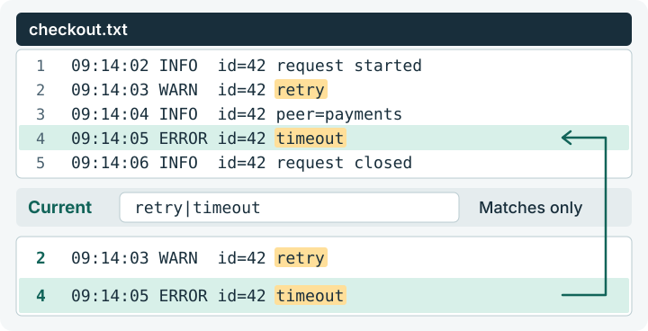

# VCLogg2 log viewer

[简体中文](../zh-CN/Home.md)

When a request times out, the line just before the error can tell you which service the request was waiting for. Open a log in VCLogg2, search for the failure, then select a match to read the lines around it. You can do the whole investigation locally on Windows, macOS or Linux.

## Follow a sample investigation

| Start with | What you can find |
| --- | --- |
| One five-line log | Identify the upstream service named just before a timeout and mark the clue. [Trace your first timeout](Getting-Started.md) |
| A request handled by the gateway and payments services | Find four related records in a folder and determine which service reported trouble first. [Download and search both logs](Search-and-Filters.md#find-a-request-in-a-folder-on-disk) · [Compare the merged timeline](Result-Export.md#put-two-services-on-one-timeline) |

For a first installation, [choose the package for your platform](Installation.md).

## What are you trying to do?

| I want to… | Open this guide |
| --- | --- |
| Read a file, a folder or yesterday’s session | [Open files and folders](Opening-Files.md) |
| Find a phrase in this file or across a directory | [Search logs](Search-and-Filters.md) |
| Use a teammate’s filter on my logs | [Download and use a cloud filter](Cloud-Filters.md) |
| Keep an important line and explain why it matters | [Mark, color and annotate](Marks-and-Highlighting.md) |
| Make dense logs easier to read | [Change font and spacing](Settings.md) |
| Search, jump or mark from the keyboard | [Keyboard shortcuts](Keyboard-Shortcuts.md) |

For a running service, follow new lines as they arrive. For a handoff, save just the relevant results. [Live logs](Live-Logs.md) · [Export results](Result-Export.md) · [More workflows](User-Guide.md)

## Help and development

[Troubleshooting](Troubleshooting.md) · [Privacy](Privacy-Notice.md) · [Architecture](Architecture.md) · [Build from source](Building.md) · [Contribute](Contributing.md)
