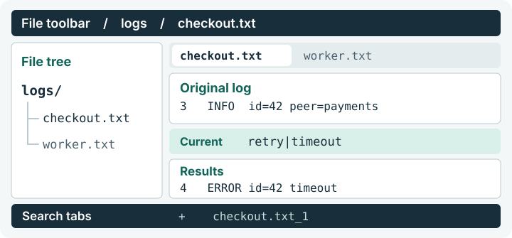

# Find your way around the workspace

[简体中文](../zh-CN/Interface.md) · [Guide home](Home.md)

Open a file and start with its name in the toolbar. The path tells you which copy of the log you are reading. Click a path segment to reveal it in the left file tree, or use the copy button to pass the full path to a teammate.

## Read the original and the matches together

*Workspace map with the optional file tree open. The original log and the results each keep their own scroll position.*

Read the original log above the search bar. The results below keep the original line numbers. Select result **4** and you can read line **3** above it in the original. Drag the divider to give either area more room. Press **W** with the log focused to wrap a long line. Wrapped text still has one source line number.

## Switch files or switch questions

| Where | What it changes |
| --- | --- |
| File tabs | Choose the document to read. Drag a tab to reorder it. Rename its display title or use its context menu to move or copy it to another window. |
| Left navigation | The toolbar’s **Show sidebar** button reveals the file tree. **Vertical tabs** in the sidebar actions menu shows open tabs down the left. Hiding the sidebar restores the horizontal tabs. |
| Search tabs in the status bar | Keep separate questions and results. Use **+** for a new current-file, global or directory search. The list button finds a tab even when the strip is collapsed. |
| Status bar | Check file size, encoding and source position. The notification panel keeps messages from the current run. |

Quick find searches whichever log or result area you last clicked. Settings open in their own window. [Keyboard navigation](Keyboard-Shortcuts.md) · [Mouse and selection gestures](Interaction.md) · [Layout reference](UI-Layout.md)
