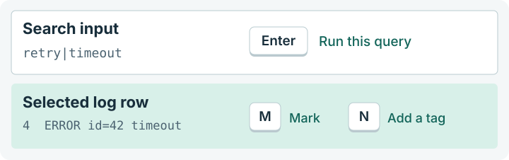

# Keyboard shortcuts by task

[简体中文](../zh-CN/Keyboard-Shortcuts.md) · [Guide home](Home.md)

Start in the log. Press **Ctrl+F / ⌘F**, enter a query and press **Enter**. Click a result, then press **M** to mark the source line. For letter shortcuts, focus matters. Typing `m` in the search box adds a character to your query.

## Customizable defaults

These are the defaults for a new configuration. **Help → Keyboard shortcuts** opens the same category as **Tools → Settings → Shortcuts**. Select a binding and press the keys you want, clear it or restore its default. Resolve highlighted duplicates to apply the change.

| Action | Windows / Linux | macOS |
| --- | --- | --- |
| Open a file | Ctrl+O | ⌘O |
| Focus the main search field | Ctrl+F | ⌘F |
| Quick find in the last clicked log or result area | Ctrl+Shift+F | ⌘⇧F |
| Toggle case sensitivity | Alt+C | ⌥C |
| Jump to the end of the log | Ctrl+End | ⌘End |
| Toggle word wrap | W | W |
| Cycle the color of selected text or rows | Ctrl+D | ⌘D |
| Add a text tag to one selected row | N | N |
| Enter edit mode | I | I |
| Close the active file tab | Ctrl+W | ⌘W |
| Open or close Settings | Ctrl+, | ⌘, |

## Fixed commands

| Action | Windows / Linux | macOS |
| --- | --- | --- |
| Mark or unmark selected rows | M | M |
| Jump to a source line | Ctrl+G | ⌘G |
| Jump to the start of the file | Ctrl+Home | ⌘Home |
| Copy selected text or rows | Ctrl+C | ⌘C |
| Copy rows with source line numbers | Ctrl+Shift+C | ⌘⇧C |
| Select all in the focused log area | Ctrl+A | ⌘A |
| Reload the current file | F5 | F5 |
| Open a new window | Ctrl+Shift+N | ⌘⇧N |
| Open clipboard text as a temporary document, outside an input | Ctrl+V | ⌘V or Ctrl+V |
| Save the document in the editor | Ctrl+S | ⌘S |
| Toggle full screen | F11 | ⌃⌘F or F11 |

## Navigate the region with focus

- **Original log or results.** Arrows move between rows. PageUp/PageDown move by a page. Shift with the arrows, paging keys or Home/End extends the selection. Ctrl+wheel changes log font size.
- **Quick find.** Enter or F3 moves to the next occurrence, Shift+Enter or Shift+F3 to the previous one. Esc closes quick find.
- **Search-tab strip.** Left/Right switches tabs, Home/End selects the first or last and Alt+Left/Right reorders. F2 renames, Delete/Backspace closes, Enter returns to the query.
- **Settings window.** Esc or Ctrl+W / ⌘W closes the window. Valid preference changes save automatically.

[Search scopes and quick find](Search-and-Filters.md) · [Row marks and colors](Marks-and-Highlighting.md) · [Editing and saving](Editing.md)
