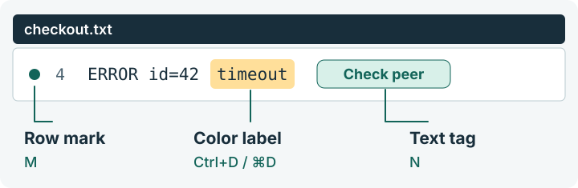

# Mark a clue and explain it

[简体中文](../zh-CN/Marks-and-Highlighting.md) · [Guide home](Home.md)

Take line 4 of the walkthrough log. You might want to find this particular line later, notice the word `timeout` elsewhere, or leave a note about the next thing to check. Each has its own control.

## Keep a line in your results

Click a source or result row and press **M**. Switch results to **Marks only** to see the lines you have picked, or **Marks & matches** to read them alongside hits. Marking several rows at once fills in any missing marks. If all selected rows are already marked, **M** removes their marks.

## Give a word a color

Double-click `timeout` in the log to select the word, then press **Ctrl+D / ⌘D** to cycle its color label. The file remembers the text rule. With no text selected, the command uses the nonempty text of the selected rows. Change the palette in **Settings → Highlight → Color labels**.

## Leave a note for your next session

Select one source row, press **N**, type **Check peer** and choose **Add**. The text tag appears at the end of the line and the row is marked. Double-click the tag to edit it. Notes and colors stay in the file session. Copying or exporting the line gives you the original log text. [Style and reuse text tags](Row-Tags.md)

## Color matches and log levels automatically

- **Search hits.** Enable **Highlight → Highlight search matches**. In **Settings → Highlight → Search matches**, choose how main-search and quick-find matches look.
- **Log levels.** Open **Settings → Highlight → Log coloring**, choose a group suited to the log format and choose **Use this group** if it is not already active. Turn on **Enable coloring**. Rules can style the whole line or just the matched keyword. Presets include Android Logcat, Java / Spring, Python and Nginx errors.
- **Selection.** The **Selection style** tab controls how selected text and rows look. Use the source line number and the mark column to identify a row even if you change the colors.

[Try this on the sample log](Getting-Started.md) · [Choose a result mode](Search-and-Filters.md)
