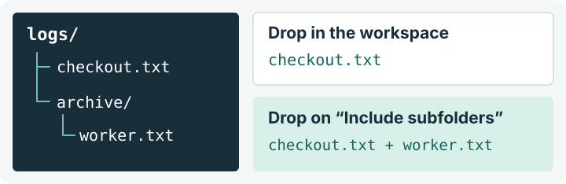

# Open files and folders

[简体中文](../zh-CN/Opening-Files.md) · [Guide home](Home.md)

## Open one log or several

Choose **File → Open…**, use the open button on the file toolbar, or press **Ctrl+O** (macOS **⌘O**). Select one or several files in the picker. You can also drag them from your file manager into the workspace. Each file has its own tab. Opening the same path again takes you to the existing tab.

A large file can show its first lines while the full index is being built. Once indexing finishes, you can search the entire file, jump to a source line with **Ctrl+G / ⌘G**, or jump to the end.

## Drop a folder

Drag a folder over the workspace and pause before releasing. The drop target determines which files open. In the example, `logs/` contains one file and a subfolder.

- **Workspace** — release here for the files directly inside the folder.
- **Include subfolders** — release over this central target to open files at every depth. You can drop files and folders together. New tabs follow the traversal order, with entries sorted by name within each folder.

Only looking for one phrase somewhere on disk? Select **Directory** in the search bar and choose a folder, extensions and whether to include subfolders. You can open a file from a match. [Try directory search with two logs](Search-and-Filters.md#find-a-request-in-a-folder-on-disk)

## Find your place again

| If you have… | Use… |
| --- | --- |
| A file you opened recently | Recent files in the empty workspace. Pin a frequently used file for next time. |
| Files from the previous session | Choose **Previous files** in the empty workspace to reopen them. |
| A file open deep in a directory tree | Click its name or a folder in the toolbar path to reveal it in the left file tree. |
| Text copied from a ticket | **File → Open clipboard as temporary file…** opens the text in an editable temporary document. [Search a ticket snippet](Editing.md#search-a-snippet-copied-from-a-ticket) |

On Windows, **Tools → Settings → Advanced → File context menu** adds **使用 vclogg 打开** for the current user. On Windows 11, look under **Show more options** in Explorer.

If the file is still growing, leave its tab active in the foreground window. **View → Follow end** keeps the newest lines in view. [Watch a new line arrive](Live-Logs.md#watch-one-line-arrive)
