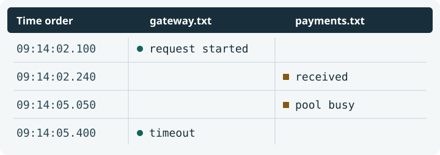

# Export results or merge two logs by time

[简体中文](../zh-CN/Result-Export.md) · [Guide home](Home.md)

Choose whether the recipient should read each file separately or follow events across files in time order. Right-click the **results area** for the commands available in the current scope.

| What you need | Choose | Destination |
| --- | --- | --- |
| A log to hand to a teammate | **Save to file…** | A path you choose. Current-file results keep their row order. Multi-file output groups rows under full-path headings. |
| A smaller log to keep searching | **Open in new tab** | A result file in the application’s temporary directory, opened in a new tab. |
| One timeline across several logs | **Merge results in new tab** | Global or directory results in a new temporary tab, interleaved by timestamp without file headings. |

## Put two services on one timeline

1. Open [gateway.txt](examples/incident/gateway.txt) and [payments.txt](examples/incident/payments.txt). Choose **Global** and select just those two files.
2. Search for `id=42`, press Enter and choose **Matches only**. Look for two hits per file. If there are fewer, check the line boundaries and per-file match limit.
3. Right-click the results and choose **Merge results in new tab**. Read the new tab from top to bottom. The payments service reports `pool busy` **350 milliseconds** before the gateway reports `timeout`.

The merged file keeps the original line text. The illustration adds source columns so you can follow each service. To copy individual records, select them and use **Ctrl+C / ⌘C**. **Save to file…** captures the last completed result set, including rows outside the viewport. The per-file match limit still applies. To include a marked context line, switch to **Marks & matches** first. Export writes log text without visual dots, colors or annotations.

## Which timestamps work?

A source line must start with `MM-DD HH:mm:ss`, a decimal point and **1–6 fractional digits**. A `T` may separate the date and time, as in `11-18T09:14:02.240`. Each input file should already be in chronological order. Merging preserves its internal line order. Equal timestamps use file order and then source line number.

Continuation lines inherit the nearest preceding time in the same file. At the beginning of a file the merge can look ahead to its first timestamp. If an entire file has no recognizable times, its hits come after timed records. The five-line introductory sample has time-of-day only. The two downloads above include a month and day for this exercise.

An ordinary save writes and syncs a temporary file in the destination directory before replacing the target. Canceling the dialog leaves it as it was. Temporary results stay out of recent files and startup recovery. To keep a merged file, copy its path from the toolbar and use your file manager to copy it to a permanent folder.
