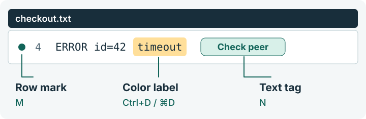

# Add, reuse and remove text tags

[简体中文](../zh-CN/Row-Tags.md) · [Guide home](Home.md)

An error may be easy to find again. A text tag preserves the reason you cared about that particular line. Searches, copies and exports continue to use the original log text.

## Leave a note beside one line

1. In the [five-line sample](Getting-Started.md), click source line 4 and press **N**. You can also right-click it and choose **Text mark → New mark…**. If you found it in a directory search, open its file and let indexing finish first.
2. Replace the generated name with **Check peer**. Enter 1–128 characters on one line. Inspect the style in the preview below and choose **Add**.
3. The note appears at the end of the line and the row gains a mark in the margin. Double-click the note to edit it and choose **Save** to confirm, or **Cancel** to discard the draft.

## Reuse a note

If you often mark lines “Review later”, right-click another row and pick that name from **Text mark**. The menu lists the ten most recently used entries. For an older one, choose **New mark…** and search **Mark history** on the right. Selecting an entry fills in the text and style so you can adjust it before adding. Two rows with the same note can be edited independently.

## Position and style

A new tag follows the line text and any existing tags. Vertical centering starts enabled. Drag the tag **on the log row** to move it sideways. Turn centering off to move it vertically too. Dragging in the dialog only changes the preview. Press **Esc** during a drag to restore its previous position.

The base line height limits tag height and font size. Transparency runs from 0% (opaque) to 100% (fully transparent). Use the preview to check a saved font, foreground, background and shape against your log.

## Remove the right item

| What to remove | Action and scope |
| --- | --- |
| One note on one line | Right-click the note and choose **Delete mark**. The row mark and reuse history remain. |
| All text notes in this file | Right-click a row and choose **Text mark → Clear all marks**. This includes rows outside the current results. Row marks and reuse history remain. |
| A name from reuse history | Delete its entry from the history list in the dialog. Notes already attached to logs remain. |
| The dot in the margin | Select the marked row in the log and press **M**. [Row marks and result modes](Marks-and-Highlighting.md) |

History is case-sensitive and keeps the most recent style for each name. When the source line changes, an old tag can be hidden until the line matches its recorded content again.
