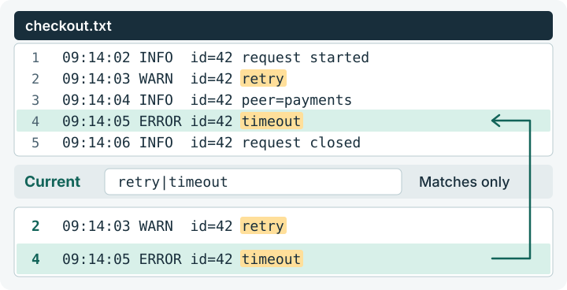

# Search logs and read the surrounding lines

[简体中文](../zh-CN/Search-and-Filters.md) · [Guide home](Home.md)

## Find every retry or timeout

Open the sample from the first walkthrough. Press **Ctrl+F** (macOS **⌘F**), choose **Current**, turn regex off and search for `retry|timeout`. Press **Enter**. With **Matches only**, the results show source lines **2** and **4**. Select line 4 to read what happened just before it. [Get the sample log](Getting-Started.md)

## Choose where to look

| If the clue might be… | Scope | How to narrow it |
| --- | --- | --- |
| In the log you are reading | **Current** | Set start or end lines in a row’s context menu. |
| In one of several open tabs | **Global** | Right-click the scope control to choose files. Expand the matching file groups. |
| In a folder on disk | **Directory** | Enter or choose a path and configure extensions, subfolders and hidden directories. A search uses the files present at execution time. |

Line limits apply to the search tab and file. Both endpoints are included. An open end extends to the last line. Out-of-range text dims immediately. Submit again to update the results.

## Choose how to match

- **Literal search.** A vertical bar separates alternatives. Spaces count, including at either end. Other punctuation such as `.` matches itself.
- **Regex search.** Enable regex to find a pattern, for example `ERROR.*id=[0-9]+`. On the sample this selects line 4. Patterns run on one line at a time. Rust regex supports neither look-around nor backreferences. A syntax error leaves the previous results available.
- **Quick find inside a pane.** Click the log or results, then press **Ctrl+Shift+F / ⌘⇧F**. Use **Enter / Shift+Enter** for the next or previous occurrence, **Esc** to close. Quick find has its own case, whole-word and regex options. Its literal mode searches for the actual `|` character.

## Keep another search open

Use **+** in the status bar to start a second search. For instance, keep `retry|timeout` in one tab and search for `id=42` in another. Each keeps its draft, result mode, selected rows, folded groups, scroll position and per-file line limits. Case and regex switches are shared. Run the query again after changing them.

Double-click a search tab to rename it or drag to reorder it. The list button finds tabs when the strip is crowded. Closing the last current-file search tab also starts that file’s close procedure. Global and directory searches may all be closed and recreated with **+**.

Each window runs one search at a time and queues the others. Switching tabs lets a search finish in the background. Submitting again on the same tab replaces its previous job. Stop cancels the current tab’s search. The last completed results stay visible until the next set is ready.

## Decide which lines to keep

| Result mode | With lines 2 and 4 matching and line 3 marked |
| --- | --- |
| Matches only | 2, 4 |
| Marks only | 3 |
| Marks & matches | 2, 3, 4. A row that both matches and is marked appears once. |

An empty query can show marked lines. **Settings → Search** controls the maximum matches per file. With a nonzero limit, each file contributes its first N matches and the export uses the resulting set. Set the limit to **0** and rerun the search when you need all matches.

Recall a previous query from suggestions or manage it in **Settings → History**. To reuse a named rule, select it under **Filters** and submit the query. A regex filter can enable regex mode. [Reusable filters](Cloud-Filters.md) · [Export results](Result-Export.md) · [Search performance](Search-Performance.md)
