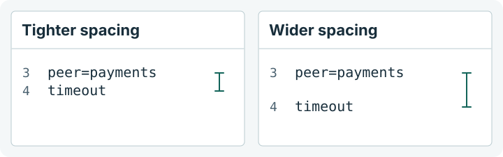

# Adjust the workspace for reading

[简体中文](../zh-CN/Settings.md) · [Guide home](Home.md)

## Give dense logs more space

Open a log and leave a few results visible. Choose **Tools → Settings → Log reading** (or open Settings with **Ctrl+, / ⌘,**). Change **Log font size** to make the characters larger. Adjust the extra line spacing to separate adjacent records. Watch the four sample lines at the top of the page. Highlights & annotations uses the same lines to preview log-level colors, search and quick-find matches, and selections.

Valid changes apply across windows and save automatically. Close Settings with **Esc** or **Ctrl+W / ⌘W**. To undo an appearance change, set the value back. Font and line spacing affect both original text and results. Use **W** in the log when a long line runs off the right edge.

## Where to find a setting

Type **line number color** in the sidebar search. Settings opens the first matching option, scrolls it into view and highlights the control. Select another result to jump to it, or clear the search to return to the nine categories.

| I want to… | Category |
| --- | --- |
| Choose the language, theme or app icon, adjust file and tab behavior, reduce motion, or enable the Windows file menu | **General** |
| Adjust log fonts, spacing, colors, line numbers, separators, scrolling or double-click word boundaries | **Log reading** |
| Edit color labels, selections, match styles and log-level rule groups | **Highlights & annotations**. [Highlighting guide](Marks-and-Highlighting.md) |
| Set matching options, per-file limits, match highlighting or search control sizes | **Search**. A limit of **0** allows all matches. |
| Record, clear or reset a key binding | **Shortcuts**. [Shortcut reference](Keyboard-Shortcuts.md) |
| Find recent files, manage temporary results and search history, or inspect and clear the index cache | **History & storage** |
| Change the team server address or user name and test the connection | **Cloud connection**. Choose **Test connection** to connect. [Cloud filters](Cloud-Filters.md) |
| Export or clear application logs, show frame timings or record a trace | **Diagnostics & performance** |
| Check the version, build information, libraries and licenses | **About** |

Enable **Show line numbers** to adjust their width, colors and separators. Turning it off preserves those values. **Pixel scroll distance** also applies to wrapped lines when scrolling by whole lines is enabled only for unwrapped text.

## Starting values

A new configuration uses Chinese and the light theme. Log text defaults to Consolas at 13 px with 6 px of extra line spacing. The line-number column starts at 60 px. Fonts are chosen from those available on the system, with a fallback if a saved font is missing. Existing file sessions can retain their own separators and line-number state.

**Log reading → Wrap new files by default** starts off. It sets the initial wrap mode for files without a saved session. Open tabs keep their current mode. When you reopen a file, it restores the wrap mode you last used, including changes made with **W**.

Search starts with case and regex off, match highlighting on and log-level coloring off. The toolbar and search field share a default control height of 30 px. Their font sizes can be set independently, and the controls grow to fit larger text.

**Log reading → Scrolling → Show horizontal scrollbar** and **View → Horizontal scrollbar** control the same preference across windows. Horizontal wheel navigation still works with it hidden. The notification switch is also in **View**. Messages from the current run remain available in the notification panel.
