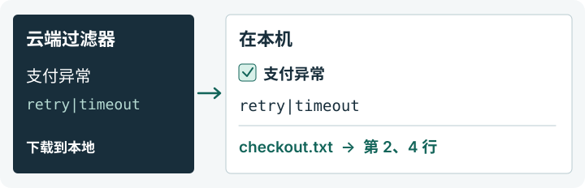

# 云端连接与过滤器同步

[English](../en/Cloud-Filters.md) · [指南首页](Home.md)

## 云端连接能同步什么

团队可以把常用查询保存为预定义过滤器，在同一台服务端分享名称、匹配值、正则开关和备注。例如，一位同事发布「支付异常」，其他人就能下载同一条规则，分别在自己的日志里查找 `retry|timeout`。日志文件和搜索结果留在各自电脑上。下载、更新和提交都由使用者发起；已下载的规则离线也能用。

<a id="connect"></a>

## 下载服务端并连接

团队已有兼容服务时，向维护者取得服务根地址，直接从第 4 步开始。首次在本机试用可按以下步骤操作。

1. **下载并解压。** 在 [VCLogg2 Releases](https://github.com/zhaiyanqi/vclogg2/releases) 打开带有服务端附件的版本，展开 **Assets**。Windows x64 选择 `vclogg-server-<version>-windows-amd64.zip`，Linux x64 选择 `vclogg-server-<version>-linux-amd64.tar.gz`。解压后，在包含 `config.example.yaml` 的目录打开终端。
2. **准备配置。** 首次启动时，Windows PowerShell 执行 `Copy-Item config.example.yaml config.yaml`，Linux 执行 `cp config.example.yaml config.yaml`。当前桌面端首次注册时不发送签名，服务端默认要求签名。仅在隔离的本机试用环境中，保留 `listen: 127.0.0.1:8787`，在 `config.yaml` 的 `client_auth` 段把 `enabled` 设为 `false`。团队部署应由维护者提供与桌面端注册方式兼容的 HTTPS 服务。
3. **启动服务。** 首次使用管理后台时，运行下方的 `admin create` 命令并按提示设置管理员密码。之后每次启动只需运行 `serve`，保持终端运行。可以在服务器本机打开 [管理后台](http://127.0.0.1:8787/admin/)。

   **Windows PowerShell**

   ```powershell
   .\vclogg-server.exe admin create -config ./config.yaml -username admin
   .\vclogg-server.exe serve -config ./config.yaml
   ```

   **Linux**

   ```sh
   chmod +x ./vclogg-server
   ./vclogg-server admin create -config ./config.yaml -username admin
   ./vclogg-server serve -config ./config.yaml
   ```

4. **连接桌面端。** 打开 **工具 → 设置 → 云端连接**。在 **服务器地址** 粘贴服务根地址，本机示例为 `http://127.0.0.1:8787`。在另一台电脑上使用团队提供的地址。**用户名** 填工号或昵称，点击 **测试连接**；看到“测试成功，已为 … 获取 Cookie”即可开始同步。

<a id="use-filters"></a>

## 使用云端过滤器

### 下载同事的规则

1. 在搜索栏打开 **过滤器 → 编辑预定义过滤器…**，切到 **云端过滤器**。也可以从 **工具 → 预定义过滤器…** 进入。
2. 在目录中按名称、关键词、备注或分享者搜索。点开一条记录，核对匹配值和修订版本。
3. 点 **下载到本地**，或勾选多条后点 **下载/更新所选**。切到 **本地过滤器** 确认规则已经出现，再回日志的搜索栏勾选它并搜索。



### 先在本机试一条规则

1. 打开 **工具 → 预定义过滤器… → 本地过滤器**，点 **+**。名称填「支付异常」，「匹配的值」填 `retry|timeout`，关闭正则。点 **完成** 回到列表，再点 **确定**。
2. 打开[入门示例日志](Getting-Started.md)，选择 **当前** 范围，清空查询框。在搜索栏的 **过滤器** 里勾选「支付异常」，就能看到两个关键词填进了查询框。
3. 点搜索按钮，在 **仅匹配** 模式下会看到第 2、4 行。同一条规则也能用在全局或目录搜索。

### 分享自己的规则，或更新已有规则

在本地列表里勾选已保存的过滤器，点 **分享** 并确认所选条目。要更新已分享的规则，先保存本地修改，再从详情选 **提交本地修改**，发布新的修订。

| 更新时遇到的情况 | 可以怎样处理 |
| --- | --- |
| 只有云端改过 | 点 **更新本地**，取得新修订。 |
| 双方都改过 | 看云端详情给出的 **合并更新** 或 **解决冲突**。下面用「支付异常」走一遍。 |
| 想给另一个项目改一份 | 点 **另存为新过滤器**，新规则有独立 UUID；名称或内容相同也能共存。 |
| 想取回某个历史版本 | 在修订历史里点 **恢复到本地**，核对之后再决定是否提交新修订。 |

提交时如遇到他人同时更新，需要核对合并结果后再提交。删除云端分享会保留本地规则。本地列表也支持文件导入导出；当前导出 JSON v5，导入兼容 v1–v4、数组和旧版 Qt CONF/INI。导入时保留文件中未列出的现有规则。

### 两个人都改了「支付异常」，哪些值会留下？

假设你和同事都下载了同一条规则，备注原本是「查支付」。你在本地改了名称和备注，同事在线上改了备注。打开这条规则的云端详情，选 **解决冲突**。

| 字段 | 你保存的本地值 | 云端新修订 | 选完后本机的值 |
| --- | --- | --- | --- |
| 名称 | 支付超时与重试 | 支付异常（同事没改名） | 支付超时与重试 |
| 备注 | 联系支付组 | 通知值班人 | 选 **采用远程** 后是「通知值班人」 |

只有备注需要二选一。要留下「联系支付组」，在备注旁选 **保留本地**。选好后点 **完成合并**，回本地详情核对名称和备注。还需要和同事确认时，点 **稍后处理**，下次仍可从原来的共同版本继续核对。合并只更新本机。有编辑权限、且本机还有待发布的改动时，点 **提交本地修改** 才会产生新的云端修订。

### 连不上，或分享按钮不可用

- **连接失败。** 向服务维护者核对地址和鉴权方式。桌面端使用无签名注册，同仓 Go 服务端默认要求签名注册（`client_auth.enabled: true`），可能拒绝当前客户端。生产部署需要双方协议兼容，关闭签名校验仅适用于隔离开发环境。
- **分享按钮不可用。** 核对服务端是否声明 `filter-uuid-branches-v1` 能力。旧服务仍可能支持浏览和下载。
- **暂时离线。** 可以查阅缓存过的公开目录页，合入比本地基线更新且可安全合并的缓存修订。发布、点赞、删除远程分享和读取修订历史需要联网。

客户端按需请求服务的 `/api/v1` 接口。公开连接设置保存在 SQLite；`cloud/sessions/` 下的会话文件存有未经额外加密的 Cookie 和 CSRF 信息，分享诊断材料时请排除这些文件。[本地数据与隐私](Data-and-Privacy.md) · [过滤器修订参考](Filter-Branch-Acceptance.md)
