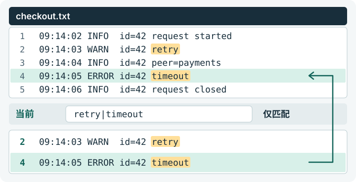

# 第一次排查：找到超时前的那一行

[English](../en/Getting-Started.md) · [指南首页](Home.md)

一笔请求重试后超时了。想知道它在等哪个服务，可以先搜到错误，再回原文读它的上一行。

## 打开示例

把[示例日志](../en/examples/checkout.txt)保存到本机，也可以把下面五行复制到纯文本文件 `checkout.txt`。在 VCLogg2 选择 **文件 → 打开…**，选中这个文件。日志会在独立标签里按原顺序显示。

```text
09:14:02 INFO  id=42 request started
09:14:03 WARN  id=42 retry
09:14:04 INFO  id=42 peer=payments
09:14:05 ERROR id=42 timeout
09:14:06 INFO  id=42 request closed
```

## 找到超时现场

1. 按 **Ctrl+F**（macOS 用 **⌘F**）聚焦主搜索框。范围选 **当前**，关闭正则。
2. 输入 `retry|timeout`，按 **Enter**。这里的竖线表示两个词命中任意一个即可。在结果区选 **仅匹配**。
3. 点击结果里的 **第 4 行**。上方原文会定位到这次超时。往上看一行，第 **3** 行的 `peer=payments` 就是请求当时在等待的服务。



如果结果少于两条，检查 **设置 → 搜索** 的每文件命中上限，调为 0（不限）后重新搜索。

## 把线索留下来

在**上方原文点选第 3 行**，按 **M**，行旁会出现一个圆点。把结果切到 **标记与匹配**，就能把第 **2、3、4** 行放在一起读。需要把这次重试、上游服务名和超时记录留给同事时，右键结果区，选择 **保存到文件…**。

想知道 `payments` 那边发生了什么？下一组示例把网关和支付服务的记录放在两个文件里。搜同一个请求 ID，就能排出两边的先后顺序。也可以留在这份五行样例，给第 3 行加上排查备注。[跨文件追这笔请求](Search-and-Filters.md#在磁盘目录里找同一笔请求) · [学习怎样给一行加备注](Row-Tags.md#在一行旁边留备注)
