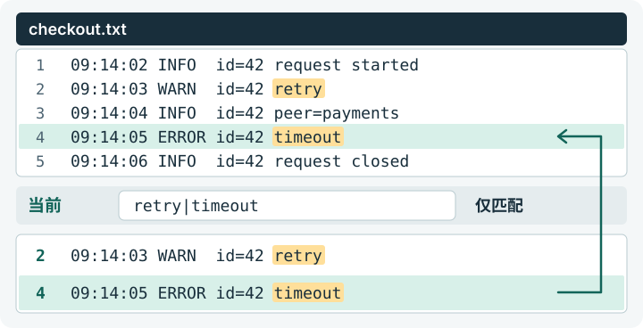

# VCLogg2 日志查看指南

[English](../en/Home.md)

一次请求超时了，哪一行能看出它在等谁？在 VCLogg2 里打开日志，搜索 `timeout`，点一下命中行，就能连同前后的记录一起读。Windows、macOS 和 Linux 都可以在本机完成这次排查。

**用五行日志试一次。** 跟着一条请求从重试读到超时，再把写有上游服务名的那一行标出来。[开始第一次排查](Getting-Started.md) · [安装 VCLogg2](Installation.md)

## 你想做什么？

| 我手头的任务 | 从这里开始 |
| --- | --- |
| 打开一个文件、一批日志，或接着读昨天的文件 | [打开文件与文件夹](Opening-Files.md) |
| 在当前日志或整个目录里找一句话 | [搜索日志](Search-and-Filters.md) |
| 用同事分享的过滤器查自己的日志 | [下载和使用在线过滤器](Cloud-Filters.md) |
| 记住一行，并留下它值得关注的原因 | [行标记、颜色与高亮](Marks-and-Highlighting.md) |
| 字太小、行太密，想换一种读法 | [调整字体与行距](Settings.md) |
| 用键盘查找、跳行或做标记 | [快捷键速查](Keyboard-Shortcuts.md) |

服务还在运行时，可以跟到最新一行；要把排查结果发给同事，可以只导出相关行。[跟随动态日志](Live-Logs.md) · [导出结果](Result-Export.md) · [更多排查场景](User-Guide.md)

## 帮助与开发

[常见问题](Troubleshooting.md) · [隐私说明](Privacy-Notice.md) · [架构](Architecture.md) · [从源码构建](Building.md) · [参与贡献](Contributing.md)
