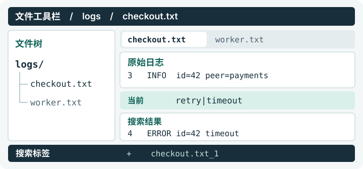

# 认清工作区里的文件、原文和结果

[English](../en/Interface.md) · [指南首页](Home.md)

打开文件后，先看工具栏里的路径，确认自己读的是哪一份日志。点击路径中的某一级，可以在左侧文件树定位它；要把完整路径发给同事，点旁边的复制按钮。

## 对照原文和命中行

*图中展开了可选的左侧文件树。原文和搜索结果各自保留阅读位置。*

搜索栏上方是原始日志，下方是保留源行号的结果。点结果第 **4** 行，就能在上方连同它前面的第 **3** 行一起读。拖动分隔区可以给原文或结果多留些空间。在日志区按 **W** 可让长行自动换行；折成几行显示的文字仍共用一个源行号。

## 切换文件，或切换正在查的问题

| 在哪里操作 | 会看到什么变化 |
| --- | --- |
| 文件标签 | 切换正在阅读的文件。可拖动排序、重命名显示标题，也可从右键菜单复制或移到另一窗口。 |
| 左侧导航 | 点工具栏的 **展开侧栏** 显示文件树。在侧边栏操作菜单选 **垂直标签页**，已打开的标签会排在左边；收起侧栏又能看到横向标签。 |
| 状态栏的搜索标签 | 保留各自的问题和结果。从 **+** 新建当前文件、全局或目录搜索。标签轨道收起后，仍能从列表找到之前的查询。 |
| 状态栏的文件信息与通知 | 查看大小、编码、源行位置，或在通知面板里回看本次运行的消息。 |

页内查找作用于最后点过的正文或结果区；设置则在独立窗口打开。[键盘导航](Keyboard-Shortcuts.md) · [鼠标与选择手势](Interaction.md) · [完整布局参考](UI-Layout.md)
