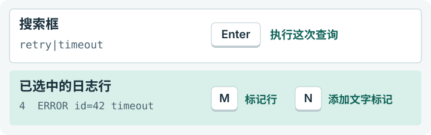

# 按任务查快捷键

[English](../en/Keyboard-Shortcuts.md) · [指南首页](Home.md)

从日志区按 **Ctrl+F / ⌘F**，输入关键词，按 **Enter** 搜索。点选一条结果，再按 **M** 就能标记对应的源行。单字母快捷键和焦点有关：光标仍在搜索框时，输入 `m` 会把这个字母加进查询。

## 可以自定义的默认按键

下面是新配置的默认值。**帮助 → 键盘快捷键** 和 **工具 → 设置 → 快捷键** 都能进入配置。选中要改的按键后直接录入，也可清除或恢复该项默认值。组合重复时会标红，解决冲突后即可生效。

| 我要做什么 | Windows / Linux | macOS |
| --- | --- | --- |
| 打开文件 | Ctrl+O | ⌘O |
| 聚焦主搜索框 | Ctrl+F | ⌘F |
| 在最后点过的正文或结果区域里查找 | Ctrl+Shift+F | ⌘⇧F |
| 切换区分大小写 | Alt+C | ⌥C |
| 跳到日志末尾 | Ctrl+End | ⌘End |
| 切换自动换行 | W | W |
| 为选中文字或行轮换颜色 | Ctrl+D | ⌘D |
| 给选中的单行添加文字标记 | N | N |
| 进入编辑模式 | I | I |
| 关闭活动文件标签 | Ctrl+W | ⌘W |
| 打开或关闭设置 | Ctrl+, | ⌘, |

## 固定按键

| 我要做什么 | Windows / Linux | macOS |
| --- | --- | --- |
| 标记或取消标记选中行 | M | M |
| 跳到指定源行 | Ctrl+G | ⌘G |
| 跳到文件开头 | Ctrl+Home | ⌘Home |
| 复制选中文字或行 | Ctrl+C | ⌘C |
| 连同源行号一起复制 | Ctrl+Shift+C | ⌘⇧C |
| 全选当前日志区域 | Ctrl+A | ⌘A |
| 完整重载当前文件 | F5 | F5 |
| 打开新窗口 | Ctrl+Shift+N | ⌘⇧N |
| 在输入框外将剪贴板文字打开为临时文档 | Ctrl+V | ⌘V 或 Ctrl+V |
| 在编辑器内保存文档 | Ctrl+S | ⌘S |
| 切换全屏 | F11 | ⌃⌘F 或 F11 |

## 焦点在这些位置时

- **正文或结果。** 方向键逐行移动，PageUp/PageDown 翻页；按住 Shift 配合方向键、翻页键或 Home/End 扩展选区。Ctrl 加滚轮调日志字号。
- **页内查找。** Enter 或 F3 找下一处，Shift+Enter 或 Shift+F3 找上一处。Esc 关闭浮层。
- **搜索标签栏。** 左右方向键切换标签，Home/End 到首尾，Alt 加左右方向键调整顺序。F2 改名，Delete/Backspace 关闭，Enter 回到查询框。
- **设置窗口。** Esc 或 Ctrl+W / ⌘W 关闭窗口。有效设置会自动保存。

[搜索范围与页内查找](Search-and-Filters.md) · [行标记与颜色](Marks-and-Highlighting.md) · [编辑与保存文件](Editing.md)
