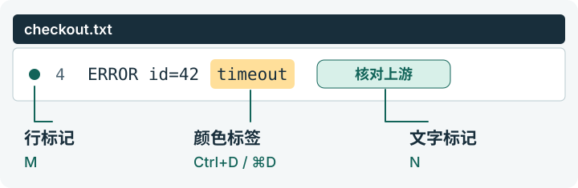

# 标出线索，记下原因

[English](../en/Marks-and-Highlighting.md) · [指南首页](Home.md)

以示例日志的第 4 行为例：想回来找这一行，可以打个圆点；想扫一眼就认出别处的 `timeout`，可以给这个词着色；想留下下次要查的事情，可以在行尾加一句备注。

## 让这一行留在结果里

在原文或结果里点选一行，按 **M**。切到 **仅标记** 可以集中读自己挑出的行，切到 **标记与匹配** 可以把它们和命中行一起读。一次选中多行按 M，会补齐还没标记的行；如果所选行都已标记，再按一次就会一起取消。

## 给一个词上色

在原文双击 `timeout` 选中这个词，再按 **Ctrl+D / ⌘D** 轮换颜色标签。这个文件会记住这条文字着色规则。没有单独选中文字时，命令使用所选行的非空文字。想换一套颜色，可以到 **设置 → 高亮与标注 → 颜色标签** 调整。

## 写下下次要查什么

点选一条源行，按 **N**，把默认文字换成「核对上游」，点 **添加**。备注出现在行尾，这一行也会加上行标记。双击备注可以再编辑。注释和颜色都随文件会话保存；复制或导出时，拿到的是原始日志文字。[调整文字标记样式与复用历史](Row-Tags.md)

## 自动突出搜索词和日志级别

- **搜索命中。** 开启 **高亮 → 高亮搜索匹配**。在 **设置 → 高亮与标注 → 搜索匹配** 里可分别调整主搜索和页内查找的匹配样式。
- **日志级别。** 在 **设置 → 高亮与标注 → 日志着色** 选择适合日志格式的分组，如果还没使用这组规则，点 **设为当前分组**，再打开 **启用着色**。规则可以给整行上色，也可以只突出关键词。预置分组包括 Android Logcat、Java / Spring、Python 和 Nginx 错误日志。
- **选区。** **选中样式** 页签控制选中文字或行时的外观。更换配色后，仍可通过源行号和标记列辨认同一行。

[用示例日志试一次](Getting-Started.md) · [选择结果模式](Search-and-Filters.md)
