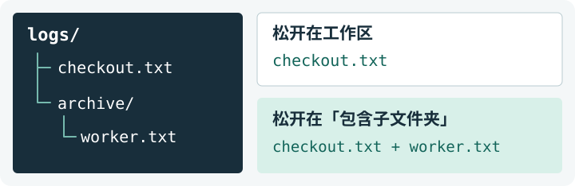

# 打开文件与文件夹

[English](../en/Opening-Files.md) · [指南首页](Home.md)

## 打开一个或多个日志

选择 **文件 → 打开…**，点工具栏的打开按钮，或按 **Ctrl+O**（macOS 用 **⌘O**）。在文件选择器里可以一次选多个文件，也可以从系统文件管理器直接拖入工作区。每份日志各有一个文件标签；再次打开相同路径，会回到已有标签。

大文件建立完整索引时，可以先读已经显示的开头。索引就绪后，就能搜索整个文件、按 **Ctrl+G / ⌘G** 跳到指定源行，或跳到文件末尾。

## 拖入一个文件夹

把文件夹拖到工作区，先别松手。松手的位置决定打开哪些文件。以下面的 `logs/` 为例，顶层有一个日志，子文件夹里还有一个。

- **在工作区松手**，打开文件夹直属的文件。
- **在中央「包含子文件夹」上松手**，打开各层的文件。文件和文件夹可以一起拖入；各目录内按文件名升序遍历，新标签也按遍历顺序排列。

只想知道哪个文件里出现过一句话？在搜索栏选 **目录**，指定路径、后缀和是否包含子文件夹，找到命中后再打开对应文件。[用两份日志练习目录搜索](Search-and-Filters.md#在磁盘目录里找同一笔请求)

## 接着上次的位置读

| 手头的线索 | 从哪里打开 |
| --- | --- |
| 最近读过的文件 | 空工作区的最近文件；经常看的日志可以加入收藏 |
| 上次退出时的一组文件 | 在空工作区选择「上一次文件」，开始恢复 |
| 已经打开，但所在目录很深 | 点击工具栏路径中的文件名或目录名，在左侧文件树定位 |
| 工单里复制的一段日志 | **文件 → 从剪贴板打开临时文件…**，文字会在可编辑的临时文档里打开。[搜索工单文字](Editing.md#查一段从工单复制的日志) |

在 Windows 的 **工具 → 设置 → 通用 → 文件右键菜单** 打开开关，即可为当前用户添加 **使用 vclogg 打开**。Windows 11 可在资源管理器右键菜单的 **显示更多选项** 里找到它。

如果日志还在写入，让这个文件保持为前台窗口的活动标签，开启 **视图 → 末尾跟随** 就能看最新行。[试着追加一行](Live-Logs.md#用示例看一次追加)
