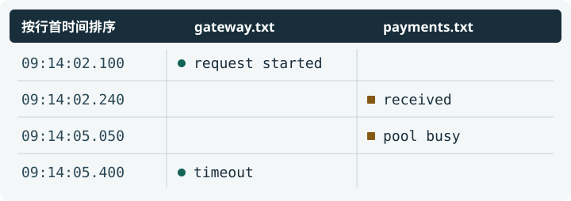

# 导出结果或合并两份日志的时间线

[English](../en/Result-Export.md) · [指南首页](Home.md)

要把错误现场交给同事，先决定对方需要按文件读，还是按发生时间读。右键**结果区**可以看到当前范围可用的命令。

| 想得到什么 | 选择 | 结果放在哪里 |
| --- | --- | --- |
| 一份可以发给同事的日志 | **保存到文件…** | 自己选择的路径。当前文件按结果顺序写出；多文件结果按文件分组，每组带完整路径标题。 |
| 在这些结果里接着查 | **在新标签页打开** | 应用临时目录中的结果文件，在新标签打开。 |
| 几份日志里同一次请求的经过 | **新标签页合并结果** | 全局或目录结果按行首时间合并到临时新标签，省略文件分组标题。 |

## 把两个服务的记录排成一条时间线

1. 打开 [gateway.txt](../en/examples/incident/gateway.txt) 和 [payments.txt](../en/examples/incident/payments.txt)。范围选 **全局**，确认只有这两份文件参与。
2. 在主搜索框输入 `id=42`，按 Enter，结果选 **仅匹配**。每个文件应各有两条命中；如果更少，检查行范围和每文件结果上限。
3. 右键结果选 **新标签页合并结果**。在打开的标签里逐行读，可以看到 payments 先报 `pool busy`，350 毫秒后 gateway 才报 `timeout`。

合并后的每一行都保留原文，来源列是上图为便于对照所加。若只想复制个别记录，在日志区选中后用 **Ctrl+C / ⌘C**。**保存到文件…** 使用点击当时已完成的整份结果，包括滚动区域外的行；每文件上限仍然生效；要导出标记的上下文，先切到 **标记与匹配**。写出时保留原始日志文字，省略界面里的圆点、颜色和文字备注。

## 哪些时间能参与合并？

源行须以 `MM-DD HH:mm:ss` 加小数点和 **1–6 位**小数开头，月日和时间之间也可用 `T`。例如 `11-18T09:14:02.240`。两份源日志应各自按时间排列；合并会保留每个文件的行序。相同时间按文件次序和源行号排列。

无时间戳的续行沿用同文件最近的前置时间；文件开头的续行会向后寻找首个时间。整份文件都找不到可识别时间时，它的结果排在有时间的记录之后。只有时分秒的五行入门样例适合练搜索；这里的两份样例含月日，可直接练时间合并。

普通保存会在目标目录写入暂存文件并同步，成功后再替换目标文件。取消对话框会保留原状。临时结果不会加入最近文件或启动恢复；要长期留存，可以用工具栏复制临时文件路径，在系统文件管理器中把该文件复制到自己的目录。
