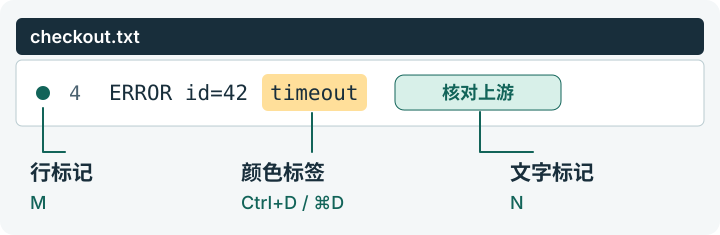

# 添加、复用和清除文字标记

[English](../en/Row-Tags.md) · [指南首页](Home.md)

一条错误可能很容易再搜到，难记的是为什么当时要留意它。文字标记把这句说明留在对应源行旁，复制、搜索和导出仍使用日志原文。

## 在一行旁边留备注

1. 在[五行示例](Getting-Started.md)的正文里点第 4 行，按 **N**。也可右键这行选 **文字标记 → 新增标记…**。如果刚从目录结果找到它，先打开对应文件，等索引就绪后再操作。
2. 把默认名称改成「核对上游」。文字可以写 1–128 个字符，限单行。在下方预览字号、颜色和位置，点 **添加**。
3. 回到日志后，行尾会出现这句备注，左边的行标记圆点也会亮起。双击备注可以编辑，点 **保存** 确认修改。要放弃这次改动，可以点 **取消**。

## 复用一条已有备注

经常要标「待复查」时，右键下一条日志，在 **文字标记** 子菜单直接选这个名字。菜单列出最近使用的 10 项。要找更早的记录，打开 **新增标记…**，在右侧 **历史标记** 中搜索并点选；文字和样式都会填入表单，改好再添加。同一句备注加在两行上，可以分别编辑。

## 调整显示位置和样式

新标记排在行尾已有标记之后，默认垂直居中。想左右移开文字，在**日志行上**拖动标记；取消垂直居中还可以上下拖动。弹窗里的拖动仅供预览。拖动途中按 **Esc** 可回到拖动前的位置。

字号和标记高度受基础行高限制。透明度为 0% 时完全不透明，100% 时完全透明。选用已保存的文字色、背景色、字体和圆角时，可以先从底部预览辨认可读性。

## 想清除哪一处？

| 要移除的内容 | 操作及影响范围 |
| --- | --- |
| 这一行的一条备注 | 右键备注选 **删除标记**。行标记圆点和复用历史仍保留。 |
| 这个文件里的全部文字备注 | 右键选 **文字标记 → 清除所有标记**。作用于整个文件，包括当前筛选结果以外的行。只清除文字备注，行标记圆点和复用历史都会保留。 |
| 历史里不再复用的某个名字 | 在弹窗右侧历史项点删除。已经贴在日志上的备注仍保留。 |
| 行旁的圆点 | 在日志区选中已标记行按 **M**。[行标记和结果模式](Marks-and-Highlighting.md) |

历史按文字区分大小写，同名保留最近一次样式。文件内容改变后，应用会核对源行；旧备注可能暂时隐藏，以免落到其他内容上。
