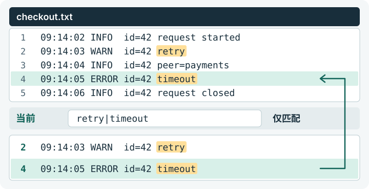

# 搜索日志，再回到原文

[English](../en/Search-and-Filters.md) · [指南首页](Home.md)

## 找出所有重试和超时

打开第一次排查用的示例。按 **Ctrl+F**（macOS 用 **⌘F**），范围选 **当前**，关闭正则，输入 `retry|timeout` 并按 **Enter**。在 **仅匹配** 模式下，结果列出源文件的第 **2、4** 行。点击第 4 行，可以回到原文看超时前发生了什么。[取得示例日志](Getting-Started.md)

## 先决定去哪里找

| 线索可能在哪 | 搜索范围 | 怎样缩小范围 |
| --- | --- | --- |
| 正在读的这一份日志 | **当前** | 在日志行的右键菜单设置起始行、结束行。 |
| 已经打开的几个文件里 | **全局** | 右键范围控件选择参与文件，展开各文件的命中分组。 |
| 磁盘的某个文件夹里 | **目录** | 输入或选择路径，设置后缀、子目录和隐藏目录条件。每次执行时读取当时的目录。 |

## 只查故障前后的几行

打开五行示例 `checkout.txt`，范围选 **当前**。在正文右键第 2 行选 **设置搜索起点**，右键第 4 行选 **设置搜索终点**。查询填 `id=42`，按 Enter，结果模式选 **仅匹配**。

| 操作 | 再次提交后应看到的源行号 |
| --- | --- |
| 起点 2，终点 4 | **2、3、4**，两个端点都包含 |
| 右键选择 **清除搜索限制** | **1、2、3、4、5** |

边界按文件保存在当前搜索标签里。只设起点就一直搜到文件末尾。修改边界时，原文范围外的文字立刻变淡；结果在下次提交后更新。

## 在磁盘目录里找同一笔请求

把 [gateway.txt](../en/examples/incident/gateway.txt) 和 [payments.txt](../en/examples/incident/payments.txt) 保存到同一个空文件夹。这个示例里有两份服务日志，其中一行是另一笔请求。

1. 在搜索栏选择 **目录**，点 **配置目录搜索…** 或右键范围按钮。输入刚才的文件夹路径，也可以点 **选择…**。
2. 勾选 **文件类型**，填 `*.txt`。实际排查时可以用 `*.txt|*.log` 同时纳入两个后缀；取消勾选则纳入所有文件类型。需要查更深一层时开启 **包含子目录**，这时才可选择 **包含隐藏目录**。
3. 确认目录配置，在**主查询框**输入 `id=42`，按 **Enter**，结果模式选 **仅匹配**。使用无限制的结果上限时，两个文件组各有两条命中。展开 gateway 组，源行号是 **1 和 3**，中间的健康检查已被筛掉。

目录搜索只在你打开某条结果时才为相应文件建立日志标签。目录里新添了文件，需要再次执行查询才能看到新命中。

要判断哪个服务先报错，保留当前目录结果，右键选择 **新标签页合并结果**。可以直接对照下一页第 3 步的图。[核对四条记录的时间顺序](Result-Export.md#把两个服务的记录排成一条时间线)

## 选择查找方式

- **普通搜索。** 竖线分隔多个关键词，命中任意一个即可。首尾空格也算查询的一部分，句点等符号按字面匹配。
- **正则搜索。** 打开正则开关，试试 `ERROR.*id=[0-9]+`，它在示例里命中第 4 行。表达式逐行执行，使用 Rust 正则语法，前后查找和反向引用不受支持。表达式写错时，仍可查看上一次的结果。
- **在眼前这一栏找文字。** 先点正文或结果，再按 **Ctrl+Shift+F / ⌘⇧F** 打开页内查找。**Enter / Shift+Enter** 跳到下一处或上一处，**Esc** 关闭。它有独立的大小写、全词和正则选项；普通模式下输入 `|` 会查找竖线本身。

## 同时保留两个问题

用状态栏的 **+** 新建搜索标签。例如，一个保留 `retry|timeout`，另一个专查 `id=42`。每个标签记住自己的草稿、结果模式、选中行、分组折叠状态、阅读位置和各文件的起止行。大小写和正则开关共用，改完重新搜索即可。

双击搜索标签可以改名，拖动可以排序。标签太多时，用列表按钮筛选定位。关闭某文件最后一个单文件搜索标签，会进入该文件的关闭流程。全局和目录搜索可以全部关闭，再从 **+** 新建。

每个窗口一次执行一个搜索，其余查询排队。切换标签时，原来的搜索可以继续；在同一个标签重新提交会替换它的上一次任务。停止按钮取消当前标签的搜索。新结果准备好前，可以继续读上一份完整结果。

## 决定结果里要留下哪些行

| 结果模式 | 第 2、4 行命中，第 3 行已标记时 |
| --- | --- |
| 仅匹配 | 第 2、4 行 |
| 仅标记 | 第 3 行 |
| 标记与匹配 | 第 2、3、4 行；同一行既命中又被标记，也只出现一次。 |

想只看标记时也可以提交空查询。**设置 → 搜索** 里的数量上限按文件生效；设为非零时，每个文件只保留最先命中的 N 行，导出也使用这份结果。需要全部命中时，将上限设为 **0** 后重新搜索。

之前输入过的查询可以从候选中选回，在 **设置 → 历史与存储** 管理。常用规则可以在搜索栏的 **过滤器** 中勾选后提交，勾选正则过滤器会开启正则模式。[复用过滤器](Cloud-Filters.md) · [导出结果](Result-Export.md) · [搜索性能](Search-Performance.md)
