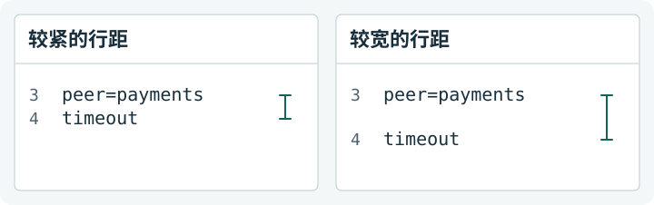

# 把日志调到适合自己的读法

[English](../en/Settings.md) · [指南首页](Home.md)

## 先试着把密集的日志拉开一些

打开一份日志，留几条搜索结果在下方。选择 **工具 → 设置 → 外观**（也可按 **Ctrl+, / ⌘,** 打开设置）。看不清字符时，调大 **日志字号**；相邻两条容易读串时，增加 **日志行距**。调节时留意工作区里的同一段文字，正文和结果都会跟着变化。

有效修改会同步到各窗口并自动保存。按 **Esc** 或 **Ctrl+W / ⌘W** 可以关闭设置。想恢复刚才的读法，把对应数值调回即可。如果只是某一行太长，在日志区按 **W** 切换自动换行。

## 我该去哪个分类？

| 想调什么 | 去哪里找 |
| --- | --- |
| 语言、路径显示、关闭确认、滚轮或双击选词的边界 | **常规** |
| 设置团队服务器地址、测试连接 | **网络**，填好后点 **保存并测试**。[在线过滤器指南](Cloud-Filters.md) |
| 主题、日志字体、字号、行距、行号或搜索控件大小 | **外观** |
| 日志级别颜色、选中文字的样式、关键词和颜色标签 | **高亮**。[标记与高亮指南](Marks-and-Highlighting.md) |
| 区分大小写、正则、每个文件最多显示多少命中 | **搜索**，上限设为 **0** 表示不限。 |
| 找回最近文件、管理临时结果或以前搜过的词 | **历史** |
| 查看状态库与索引缓存占用，清理空间 | **存储** |
| 录入新按键、清除或恢复某个快捷键 | **快捷键**，重复组合会标出冲突。[快捷键速查](Keyboard-Shortcuts.md) |
| 导出或清理应用诊断日志、更换图标、启用 Windows 文件右键入口 | **高级** |
| 查版本和构建信息 | **关于** |

## 想调回起始值时

新配置使用中文和浅色主题，日志默认为 Consolas、13 px，额外行距 6 px，行号列宽 60 px。字体从本机可用字体中选择；换到缺少该字体的机器时会使用回退字体。以前打开过的文件可能保留自己的换行、分隔线和行号状态。

搜索默认关闭区分大小写和正则，开启匹配高亮，关闭日志级别着色。搜索工具栏与主搜索框共用 30 px 的默认控件高度，字号可以各自设置；字号调大后，控件会增高以容纳文字。

**视图 → 横向滚动条** 在各窗口同步。隐藏滚动条后，仍然可以用横向滚轮查看长行。通知开关也在 **视图** 菜单里，本次运行的消息可以从通知面板回看。
